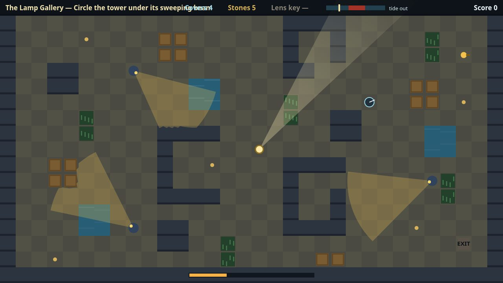

# Tidebound Light — a lighthouse stealth heist

Entered in the [make.fun](https://make.fun) bounty above. New to make.fun?
Join with the referral link https://make.fun/r/44n6pkpv

An original top-down **stealth game** for the make.fun bounty
["Make the best stealth game"](https://make.fun/bounty/best-stealth-game-20261121-1759).
You are a tide-runner on a drowned lighthouse rock at night. On each of
three floors — the **Causeway**, the **Lamp Gallery**, the **Lamp
Room** — steal the **brass lens key**, reach the **EXIT**, and do it
**unseen**.

## How to play

Open `game/index.html` in a desktop browser (or run `node serve.ts` and open
http://localhost:8080). It plays fully offline — no network request, no build
step, no dependencies.

- **WASD / arrow keys** — move
- **Shift** — sneak: slower, quieter, and harder to see
- **Mouse click** — throw a stone: keepers who hear the splash come to look
- **R** — restart the floor · **P** — pause · **M** — mute

## The stealth systems

- **Keeper lantern cones** patrol, pause and scan — and are cut short by
  rock and crates, exactly as drawn, so cover really is cover.
- **The tide** runs on a 36-second cycle, shown on the HUD gauge. The low
  causeway (the pale strip) is dry walking at low water and **drowned at
  high tide** — routes open and close twice a cycle, and the shallows
  **splash**: wading is slow and carries far, so keepers hear you coming.
- **The great lamp beam** sweeps the Gallery and the Lamp Room. Caught in
  the beam you are simply lit — kelp beds and crouching count for nothing —
  unless a wall's shadow cuts the beam first.
- **Kelp beds** (the dark green patches) make you much harder to see while
  you crouch in them, beam permitting.
- A **detection meter** fills while you are seen (faster up close and in
  the beam, slower while sneaking or in kelp) and drains when you break
  sight. Full meter: the keepers give chase. Caught, you lose one of three
  **covers** and restart the floor.
- Keepers run four states — **patrol**, **suspicious** investigation (they
  hear splashing feet and thrown stones), **distracted** by a splash, and
  **chase** — and pathfind around the rock to wherever they last saw you.
- Scoring rewards the lens key, salvage, fast clears and unspent stones —
  plus a **ghost bonus** for a floor nobody saw you on.

The levels were validated headlessly: a BFS autopilot playing the real
simulation clears all three floors with no catches, and every key, exit,
salvage coin and patrol waypoint is reachable on foot.

## Layout

- `main.ts` — the entrypoint: copies `game/` and `screenshots/` to the
  output directory and writes `dossier.json` with the vendored kit library.
- `game/` — the playable game as static files (`index.html` plus ES modules
  under `game/src/`, one clear job each: levels, simulation, rendering,
  input, sound, screenshot scenes).
- `screenshots/` — four real renders of the game, taken from its own
  deterministic `?shot=` scenes.
- `vendor/makefun-game.ts` — the kit's dossier library, unchanged.

## Licence

MIT — see `LICENSE`.
